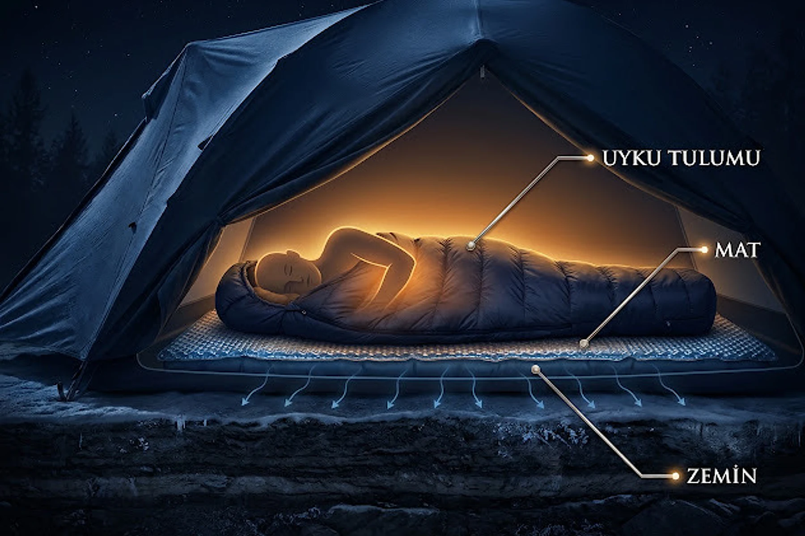
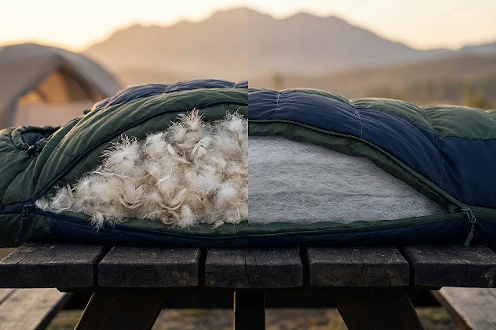
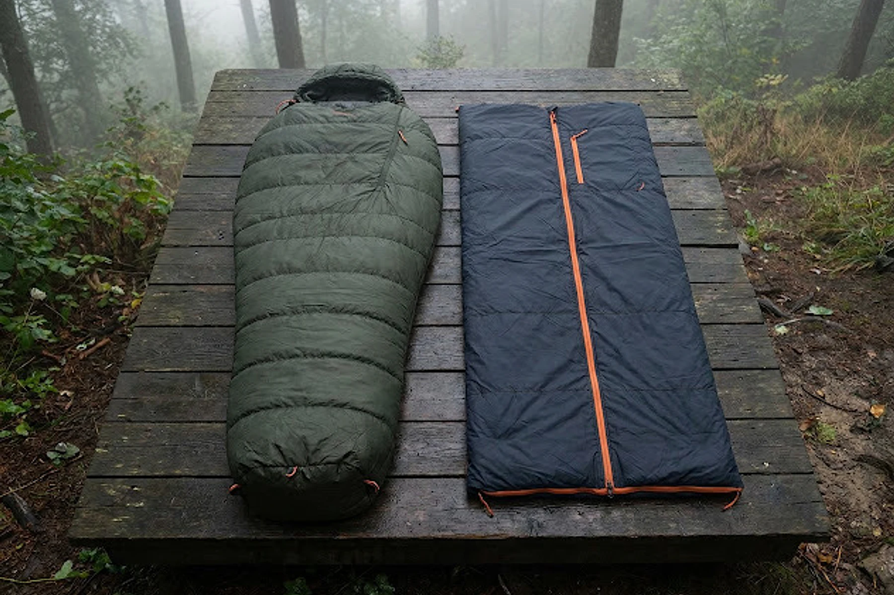
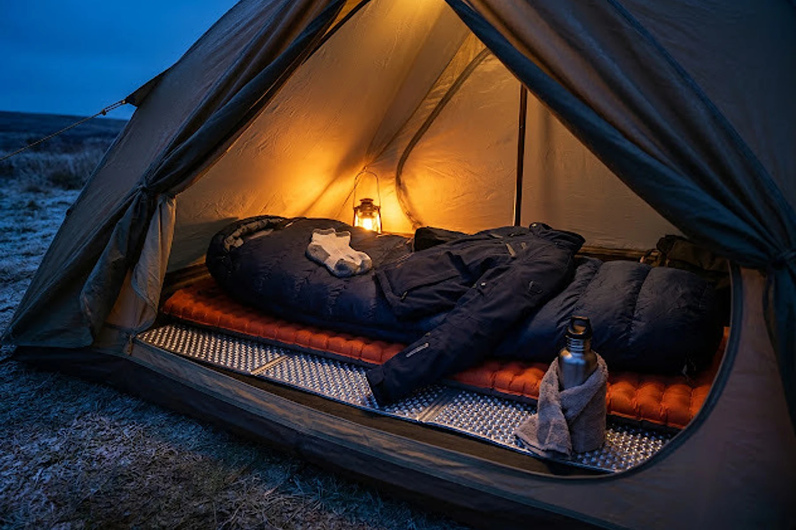

The sleeping bag doesn’t heat you on its own. Instead, it helps reduce heat loss by trapping the heat your body produces inside. Therefore, the temperature indicated on the bag, the type of sleeping pad you use, how well the bag fits your size, and the weather conditions for that night are all important factors.

Use a down jacket with a comfortable temperature suitable for the lowest expected nighttime temperature, ensure good insulation from the ground, and enter the jacket with dry clothing inside. Consider extreme temperatures only as a precautionary measure, not as a target for purchase or use.

If you haven’t bought a sleeping bag yet, read [what to look for when buying one](/uyku-tulumu-alirken-nelere-dikkat-edilmelidir/). To consider your sleep system alongside your other kit, see the [hiking gear checklist](/doga-yuruyusleri-icin-gerekli-ekipmanlar/).

## What do the comfort, limit and extreme ratings mean?

High-quality sleeping bags typically have three temperature ratings on their labels: comfort, limit, and extreme.

*Extreme values are used to indicate the limit of emergency situations, not for comfortable sleep.*

### Comfort level

This is the lowest temperature at which you can expect to sleep in a relaxed position without feeling noticeably cold. If you are sensitive to cold or are experiencing your first time camping in cool weather, this is the value you should use as a reference.

### Limit rating

This is the lower limit at which you can sleep curled up and beginning to feel the cold. The bag still works at this temperature, but you may sleep poorly.

You can technically exist between comfort and limit, but it’s possible to spend a part of the night thinking “Why did I come here?”

### Extreme rating

It is not a measure of comfort. It shows the theoretical lower limit for survival in an emergency situation. There is a risk of freezing and hypothermia at this temperature.

A sleeping bag marked `extreme -15°C` won’t let you sleep comfortably at -15°C. When you shop, look for the comfort and limit ratings. The extreme figure in big type is a different rating.

Currently, when comparing adult sleeping bags, [ISO 23537-1:2022 standard](https://www.iso.org/standard/82789.html) is being used. However, laboratory results are not a guarantee; factors such as metabolism, fatigue, humidity, wind, clothing, and your sleeping mat can alter the results.

## Does the sleeping bag’s seasonal value provide sufficient information?

sleeping bags are sometimes classified as one, two, three, or four-season options. This system is useful for the initial screening:

* One-season bags are suitable for warm summer nights and indoor use.
* Two-season bags can be used from late spring to early autumn.
* Three-season bags are designed for cool nights and temperatures just below freezing.
* Four-season bags are intended for winter conditions.
* Products designed for more than four seasons are aimed at significantly challenging winter and expedition conditions.

However, brand seasonal definitions can vary. The “summer” in England is not the same as the “summer” in Turkey. Therefore, do not rely solely on the number of seasons; if possible, examine temperature values that have been tested against a standard.

## Will I sleep comfortably at 5°C in a bag rated for comfort at 3°C?

On paper, it’s likely yes. But in reality, things don’t work with simple addition and subtraction calculations when it comes to sleeping bag ratings.

The temperature at the site where you plan to set up camp may not be the same as the city’s weather forecast. You can use a rough estimate of approximately 1°C decrease in temperature for every 150 meters of altitude when planning. However, wind, valley structure, humidity, and temperature inversions can alter this calculation. If possible, refer directly to the forecast for your specific camping location.

The thermal comfort of one of the sleeping bags I was using was around 2-3°C. On a night when the temperature was approximately 15°C, it wasn’t possible to put the zipper on and get inside; I slept by wrapping the bag around myself like a blanket. On another, colder night, I felt a slight chill in my lower back. I covered that area with my motorcycle jacket to reduce heat loss.

So, an overly warm sleeping bag isn’t advantageous in every situation. If you try to sleep inside a winter sleeping bag during the summer nights, you won’t be fighting against the cold, but against your own little “hamam” (bath).

## Is a sleeping bag alone sufficient?

No. A sleeping bag, along with mats and dry sleeping garments, constitutes a complete system.

Your body weight compresses the insulation underneath you in the bag. Because this compressed padding doesn’t hold enough air, the insulation at the bottom decreases. Therefore, the part that actually protects you from the cold surface is the mat.

A good sleep system isn't just about the sleeping bag; it also reduces heat loss from the ground, effectively minimizing it.

A sleeping mat’s `R`-value measures how much it resists heat loss. Higher values mean better insulation from the ground. When comparing brands, use values measured to the ASTM standard if available. I go into the test and what to look for in [What does the R-value of a sleeping mat mean?](/r-degeri-nedir/).

If the budget is limited, closed-cell, military-grade foam mats are effective. They are lightweight, tear-resistant, and provide good basic insulation. Their only drawback is that they aren’t particularly comfortable; you might still feel a bit of a connection with the floor when you wake up.

During cold weather, these mats can be used two layers thick. The R-values have been measured, and when used together, the insulation values approximately add up.

## Is a down or synthetic sleeping bag more practical?

There are both strong and weak sides to both types of filling. The correct choice depends on how you intend to use them.

*When choosing filling, consider not only temperature, but also humidity, weight, volume, maintenance, and budget.*

### Down insulation

The air gaps within goose or duck feathers provide excellent insulation. Goose down sleeping bags are typically lighter and more compact than synthetic models offering the same temperature level.

Down feathers can clump together and lose volume when they get wet, which significantly reduces insulation performance. Furthermore, high-quality down-filled garments are more expensive and require more careful attention during washing and drying.

If you do not wish to use animal-derived fillers or have concerns about how the feathers were obtained, you can opt for synthetic options. If you prefer goose down, be sure to review the product’s responsible sourcing certificates.

### Synthetic insulation

Synthetic blankets are generally more affordable. They tolerate humidity better than wool, and dry more easily.

These may be heavier and bulkier for the same level of performance. If you’re not planning on taking them on long hikes with a backpack, this difference may not be significant.

When traveling by car and camping, it’s not a problem to carry a slightly larger package. If you’re planning to carry your entire home with you for several days, the weight and volume of the packages become much more important all of a sudden.

## Is the fabric of the sleeping bag important?

The outer fabric provides protection against wear and tear, dirt, and light moisture. The fabric called “Ripstop” is produced in a way that slows down the growth of small tears.

Some of the jackets have a water-repellent coating called DWR on their outer surface. This coating can help with condensation or light moisture, but it does not make the jacket waterproof.

Saying “It says ‘DWR’ on it” and leaving the sleeping bag outside in the rain isn’t very effective. Especially when carrying a wool sleeping bag, it’s much safer to use a separate, waterproof bag or a lining for the bag.

The fabric’s inner surface should be comfortable against your skin and able to manage moisture. Cotton blends can be soft, but they are also heavier and take longer to dry when wet. For technical use, lighter synthetic fabrics are more practical.

## Is it a mummy-style sleeping bag, or a rectangular sleeping bag?

The rectangular blankets are wide and comfortable. They can be used like a duvet when the zipper is fully opened. They are very useful for summer camps by car or in enclosed spaces.

But there are more areas that need to be heated inside. And their heaviness and volume also create a disadvantage during walking.

Mummy-style parkas prioritize warmth, while rectangular models prioritize mobility.

Mummy-style parkas narrow from shoulders to feet. Thanks to their hood, neck cinch, and smaller interior space, they effectively retain heat in cold weather. However, this comes at the cost of reduced mobility.

Choosing the right size is also important. If the jacket is too long and wide, you’ll create extra air volume. If it’s too tight, it can reduce insulation by compressing your body and pushing the padding outwards.

If you are considering a [double sleeping bag] for two people, you can also evaluate [the advantages and disadvantages of double sleeping bags](/iki-kisilik-uyku-tulumu-hakkinda/).

## What should you wear inside a sleeping bag?

The repeated belief that one must enter a sleeping bag completely naked or only wearing a thin pajama is a frequently cited one. In reality, wearing dry and appropriate clothing can actually help you stay warm.

My preferred basic structure would be as follows:

* A dry underlayer or a comfortable sleep garment
* Dry socks
* If needed, a thin hat.
* Layers with insufficient volume and that prevent blood circulation.

Throughout the day, don’t wear sweaty clothes and get into a wetsuit. Dampness not only cools you down but also eventually dirties the inside of the wetsuit.

On the other hand, also forcing oneself to wear all coats together and create a tight cocoon is not a good idea. Bulky clothing can compress the volume of the cocoon, restrict movement, and cause you to sweat.

The main aim is not to overdress, or to dress excessively, but rather to remain dry and not compromise the insulation of the cloak.

## What can I do if I’m cold while sleeping in my sleeping bag?

First, try to understand where the problem is coming from. If your back and hips feel cold, the problem is likely due to moisture. If your neck and shoulder area feel cold, check the strap and the wind strip behind the collar.

*Apply additional insulation first on the ground, and then reinforce it in areas where heat loss occurs.*

You can try the following:

1. Change your damp clothes for dry layers.
2. Put a light scarf on your head.
3. Close the head and neck settings of the Tulum, but do not allow your breath to enter it.
4. Add a second foam mat beneath the Tulum.
5. Cover your mountain with the blanket, over the area where you feel cold.
6. Do some light exercise before bed so you don’t get too hot.
7. Consume warm liquids and do not sleep on an empty stomach.
8. Use a leak-proof thermos, filled with hot water, and wrap it in a towel. Place it inside the sleeping bag.

I used single-use adhesive heaters in the past, specifically on my feet and lower back. However, the packaging of many standard products states that they should not be used while sleeping and should not be applied directly to the skin. Prolonged contact at low temperatures can cause burns. Only use products where the manufacturer explicitly states that they are suitable for use during sleep, following the instructions provided.

Instead of filling a single-use PET bottle with boiling water, use a secure thermos with a spout. A bottle with a spout inside will not only wet you; it can seriously cool the rest of the evening.

The trembling is becoming uncontrollable, the speech is becoming distorted, and if there’s difficulty with movement or confusion, the situation is no longer about comfort. These could be symptoms of [hypothermia](https://www.nhs.uk/conditions/hypothermia/). Get out of the cold environment and seek urgent assistance.

## Is an inner lining for the sleeping bag necessary?

The sleeping bag liner protects the inside of the sleeping bag from sweat and dirt. It’s particularly useful on long journeys because it’s easier to wash than the sleeping bag itself.

Cotton pads can be affordable and comfortable, but they are heavy, pack large, and take a long time to dry when damp. Silk or lightweight synthetic pads pack smaller. Polar pads, on the other hand, can be warmer, but they are heavy and bulky.

It is claimed that some products are said to add a specific temperature in degrees. Do not rely on this as a definitive result. The benefit provided by the coating varies depending on the coating, mat, paint, and the person’s metabolism.

Astar, doesn’t replace your winter coat. It adds a bit of flexibility to the system you’re using.

## How do you wash and store a sleeping bag?

You don’t necessarily need to wash your sleeping bag immediately after each trip. First, completely open it, air it out, and if it’s damp, dry it. Often, simply cleaning small spots locally is enough.

If you need to clean:

* Read the manufacturer's maintenance label.
* Use a cleaning agent suitable for the type of sealant being used.
* Do not use softening or smoothing.
* Make sure the fur coat is completely dry before you lift it.
* If you are going to use a tumble dryer, please select the low temperature recommended for the product.
* Do not lift a wet suit from just one corner; it could damage the seams of the filling, which could become heavy.

The sack is intended for travel. Do not store the sack, compressed, for months when you return home. Place it loosely in a large, breathable storage bag or hang it in a suitable location.

The air spaces within the dough provide insulation for the bag. If the bag remains constantly compressed, it may eventually lose its ability to return to its original volume.

## What is the summary of how to get good results from a sleeping bag?

Instead of relying on a single number regarding etiquette, evaluate the entire sleep system.

* Base the comfort value on the expected lowest temperature.
* Do not consider it as a target for extreme values.
* Use a mat with a thermal resistance (R value) suitable for the ground.
* Enter the cave wearing dry and comfortable clothing.
* Choose either mummy or rectangular, depending on your intended use.
* When choosing filling, opt for feathers or synthetic filling based on the likelihood of moisture.
* Store your bedding in a dry, clean, and uncompressed state.

A good sleep tent doesn't eliminate cold air. It allows you to get out of the tent feeling rested in the morning.

What type of sleep suit did you use, at what temperature, and on what type of mat? Did the comfort level match your actual experience? If you share your comments with the brand, model, nighttime temperature, and mat information, you’ll provide a truly helpful comparison for those looking for a new suit.
