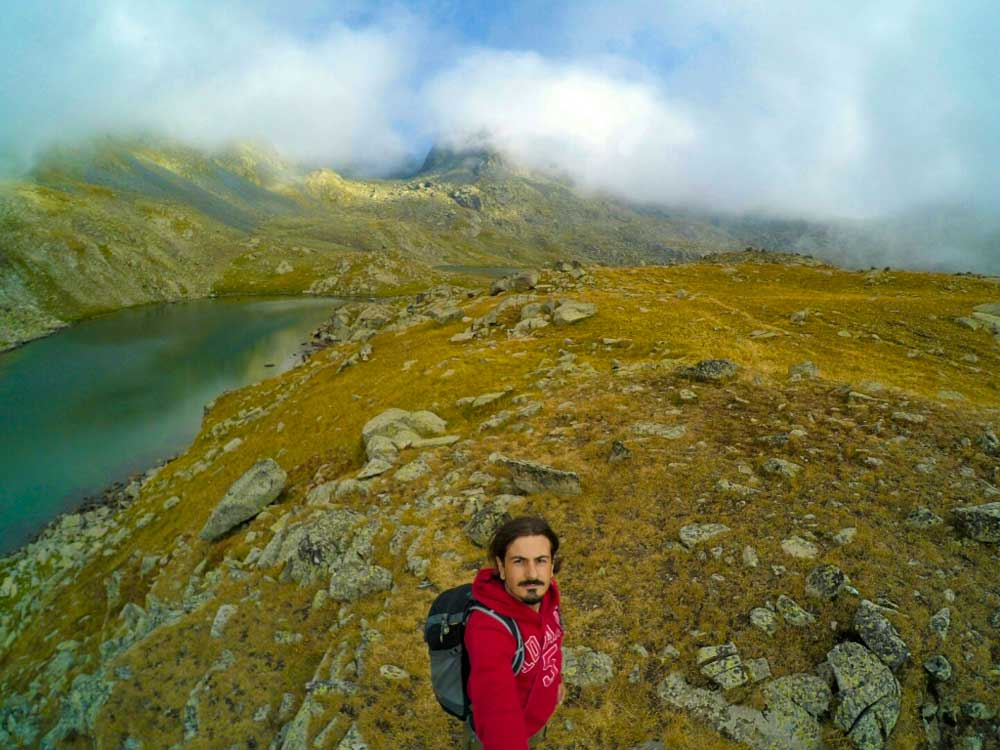

August 31, 2015 While we were saying goodbye to Simge in Pokut yaylası, we encountered someone who was praising Verçenik yaylası. “Verçenik is my second favorite,” a friend told us. “I know it’s above Çat vadisi, but I’ve never been there.” We decided, “Since we’ve come this far and been so encouraged, we should go to Verçenik yaylası.” And since we were there, we thought we could take a walk and see the craters and perhaps set up a tent, so we set off.

As we were moving towards Çat valley, we first saw Zilkale, and then arrived at the Toşi restaurant in a breathtaking natural landscape, where every place was filled with green. After Toşi, the road became rough. Continuing for a while as a dirt road, it then transitioned to a rocky path. While riding our vehicle towards the plateau, we started to feel a bit stressed when the fuel gauge in our vehicle suddenly dropped. When we drove on a flat road and the car ran out of fuel, hitting the mountain, the fuel was completely depleted. As we continued anxiously, at approximately 15:00, the fuel light finally turned on, and we arrived at the plateau. We reassured ourselves by saying that at least the return slope was downhill.

There was a heavy fog in Yaylada. Clouds were passing overhead. Although the visibility sometimes increased, we prepared for a walk with the awareness that we would be walking in the fog. As we were walking, we ran into Osman abiler. We both met and encountered them. He also has his own story. You can find it at “[Dünya Küçük](/dagin-basinda-da-dunya-kucukmus/)”. I quickly did some calculations in my head. The lakes are 3.2km away. Round trip is 6.4km. If we walk well, we can finish in a maximum of 2 hours, and it will be 17:00. I’ll meet you at 1, and we’ll arrive at 18. Since the weather is expected to darken at 19, we can walk comfortably. I started the GPS recording and we set off immediately. We walked on a 2.8km mountainous path, along a stream, through the fog. After walking through the fog, we came to a steep slope. I looked at a slope and at Simge; she was protesting. She was very tired and didn’t seem like she would continue. “You stay here, let me look up to see if the lakes are there, if not, we’ll turn back,” I said, and within 2 minutes, I reached the top. And there was another peak to see. It’s a bit steeper and longer. “Okay, we’ll definitely turn back,” but I heard a whisper, “God, we’ve come this far, where are the lakes?” I immediately looked at the map – the lakes are behind that peak. So, I quickly started thinking again: “If I call Simge, she won’t hear me, she can’t climb this slope, should we turn back having come this far without seeing the lakes, Simge is down here, she won’t leave, and she’s also a bit tired, so she can rest. And I’ll quickly get down in about 5 minutes, full of thoughts.”

When I spotted the lakes at the top, Simge suddenly came to mind. I glanced at my watch – approximately 15 minutes had elapsed. 'Off, what have I done? She must be furious. 15 minutes alone must have felt like 3 hours, and I hadn’t even told her where I was going. Oh no, oh no. I quickly captured a few photos of the lakes and began to run down. I was hurrying to avoid injury, and I was being very careful not to hurt myself. Naturally, I was thinking about Simge – what is she doing? I hope she hasn't gone elsewhere. I had a feeling that if I told her not to go anywhere, she wouldn't. But what if she has? As I hurried down, I found the correct path. Thinking I could descend faster, I continued descending from the spot I had arrived at. When I approached the hilltop, where I thought I had left Simge, I heard a sound. I looked up, and the sound was coming from above. Simge was looking upwards and calling out to me. 'Why did you go up, Simge?' I asked. 'Super, I've messed everything up. Now I'm just trying to disappear. But when I said that, Simge snapped and let me have it. She hadn't gone anywhere; only I had descended. We met up and I got an earful. As I was regretting what I’d done without thinking, Simge said, ‘I’m asking you as a human being. Get me out of here.’ At that moment, my eyes began to spin, and the images before my eyes started to flicker. It was as if my head was spinning. I began to wonder where I was and where I could turn. While looking blankly around, I said to İbrahim, 'Calm down, my friend.' 'You've eaten a lot of nonsense, but right now, you need to calm down and think about how to get out. Then, you must reconcile with yourself and apologise to Simge.' I pulled myself together. The misty atmosphere and the air turning dark were increasing our tension. I was accustomed to the mist and these mountains, but Simge was still furious. I found the path and quickly descended. Our ascent had taken approximately 1 hour and 40 minutes, and we reached the car with a super performance of 40 minutes. I realised that when Simge got angry, she walked better. Although the joy of reaching the car felt like a sweet summer breeze, my reckoning with myself fell upon me like a heavy burden. I began to feel like I was going mad, and I made no noise along the way.

We got into a car and sniffed the gasoline to descend the slope, and we decided to spend the night at Toşi’s guesthouse in Çat Valley. We talked about the issue during that evening meal. We discussed the fact that it was essential to have a radio, and that Simge also had the route information. Ultimately, I worried that if my blood pressure dropped, I would suddenly faint or something would happen, and she would be left alone. We learned from my mistakes and then finished off with dessert. However, whenever Simge recounts this, she experiences the same irritation. Therefore, it would be beneficial for her not to remember it :)