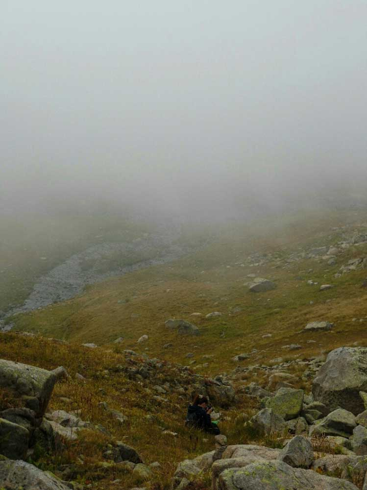

31 August 2015. Simge and I are about to leave the Pokut highlands when we get talking to some people who rave about Verçenik. “Pokut comes first for me, Verçenik second,” one of them says. I know it’s up above the Çat Valley, but I’ve never been. We’ve come this far, so why not see what the fuss is about? There are crater lakes above Verçenik. We could walk up to them, maybe even pitch the tent. Off we go.

On the way to the Çat Valley we see Zilkale, then follow a road so green it seems to be growing in every direction. We reach Toşi restaurant in the valley. Beyond it the road gets rough, first dirt, then rock. We’re in an ordinary Ford Focus. On the flat it barely sips petrol, but point it at a mountain and boy, can it drink. We watch the needle drop. It’s about three in the afternoon when we reach the highland, just as the fuel light comes on. Well, at least it’s downhill on the way back, we tell ourselves.

Thick fog up here. Clouds keep sweeping over us. Every now and then we can see a bit further, but we know what sort of walk we’re in for. While we’re getting ready we bump into Osman and his lot. That first meeting is a story in itself. I told it in [It’s a Small World, Even on a Mountaintop](/dagin-basinda-da-dunya-kucukmus/). I do a quick sum. The lakes are 3.2 km away, so 6.4 km there and back. Two hours at a decent pace gets us back by five. Throw in a spare hour and it’s six. It gets dark at seven. Plenty of time. Brilliant plan. I start recording the GPS track. We follow the mountain path beside a stream for 2.8 km in the fog and come to a steep climb. I look at the slope, then at Simge. She’s had it. “Wait here. I’ll pop up and have a look. If the lakes are there I’ll call you. Otherwise we’ll turn back.” Two minutes later I’m at the top, looking at another hill. Longer and steeper, naturally. Right, we’re definitely going back. Except there’s a little voice asking where those lakes are, now we’ve come all this way. The map says they’re just over that hill. Simge won’t hear me if I shout. She’s never going to want to climb this. She’ll stay put, she could do with the rest, and I can be up and back in five minutes. With that splendid piece of reasoning I shoot off up the hill.

I see the lakes and suddenly think of Simge. Fifteen minutes gone. Oh, bloody hell. Fifteen minutes on her own in the fog will have felt like three hours, and I didn’t even tell her. I snap a couple of pictures and run back, trying to hurry without turning an ankle. Please let her still be there. Of course she’ll be there. I told her to wait. But what if she’s gone? I find the proper path on the way down and take it to save time. I’m nearing what I think is the spot, though I suspect I might have gone a bit low, when I hear her. The voice is coming from above me. She’s looking uphill, calling my name. “Simge, why did you climb up there?” Great. I’ve made a right mess of this and now I’m putting my foot in it too. She lets me have it. She hasn’t moved an inch. I’m the one who’s gone too far down. We get back together, I take my deserved earful, and while I’m kicking myself she says, “Please. I’m asking you, one human being to another. Get me out of here.” My eye starts twitching. My vision keeps cutting out. For a moment I can’t work out where I am or which way is back. I stand there staring, then give myself a talking-to. Steady, İbrahim. Yes, you screwed up. Work out how to get out of here. You can beat yourself up and apologise to Simge later. The fog and the fading light are getting to us. I’m used to both the fog and these mountains, but Simge’s still furious. I find the path and we fly down. An hour and forty minutes up, forty minutes back to the car. Turns out Simge can shift when she’s angry. Getting back feels like a summer breeze for all of a moment. Then it hits me, what I’ve done. I can’t bring myself to say a word on the drive.

We nurse the car downhill on what little petrol we’ve got and decide to spend the night at Toşi’s guesthouse in the Çat Valley. Over dinner we talk it through. We should have had radios. At the very least Simge should have had the route too. What if my blood pressure had dropped and I’d passed out? She’d have been there on her own. We learned a few things from my mistake and made our peace. Mind you, Simge gets just as cross every time she tells this story. Best not remind her :)