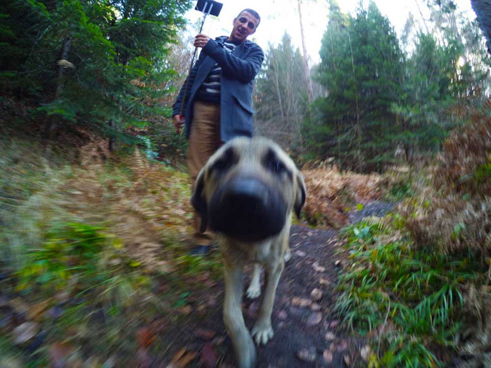

If a bear ever comes to the campsite. Have you ever heard a bear sound at the campsite? I heard a sound, but was it a bear or a cow?

### BOZCAARMUT GÖLETİ – 26-27 NOVEMBER 2016

Over breakfast at about 9 on Sunday morning, we made plans to go for a walk afterwards. A lively dog was hanging around, trying to get some food out of us. The little rascal was happy to be petted, too. Suddenly we heard gunshots in the distance and the dogs started barking. Once the shots stopped, the dog beside us got up, barked a few times and traded barks with the others. Then it looked miserable and started whining. There was nothing left of the cheerful dog from 5 minutes earlier. We asked, “What’s up, mate? Why so sad?” No answer, of course. We couldn’t work out what had happened. We put it down to hunters and moved on.

### Why was a bear shot?

We set off on a hike and covered about 20km in 6 hours, pushing ourselves to the limit. By the end of the day, we were exhausted. When we met the guard at the lake entrance, we were talking about how far we had walked and showing him the bear tracks and bear droppings we’d seen, when the guard told us that hunters had shot a pig and a bear that morning. We got angry, upset, and depressed. As we made our way to the campsite, we finally understood why the dog by our side had looked so sad that morning. How can you shoot a bear? How can you shoot an animal at all? It’s hard to understand. It’s a question we couldn’t answer.

### Is that the sound of a bear?

We had just returned from a walk, so we didn't have much time to recover – it was already late. By around 18:30 everyone had left and the sky was beginning to darken. We had eaten to fill our stomachs, had some tea, and tidied our belongings. There were only 3–5 items left to put away slowly into the car when we heard a sound in the trees. "Is that a bear?" Fatih abi said, but he insisted it wasn't a cow. "Look, if you're serious, have you ever seen a cow around here? It seems the bear is coming to take revenge." "Come on, let's quickly load everything into the car, because someone must have shot a bear in the morning, and it's coming for revenge." Fatih abi said, "The grill hasn't cooled down yet." I was feeling quite at ease, thinking about what was to happen. "If the bear attacks, we have no chance." Actually, we were on the same side as the bear, but it had no idea. The car was not right at our feet either. As we were heading to the car, the bear was barking at us. While we were putting the last items into the car, it roared once more. This time, both of us were feeling quite exhausted. We quickly loaded everything and got in. Just as we were about to set off, we needed to go back a little; Fatih abi said, "Ibrahim, look behind you, can't I see how far back we are?" A friend forced me to approach the bear. We pressed the horn several times, turned on the car's lights (aiming to scare the bear), then I called out, "Come here," and we set off.

We thought about and discussed what happened on the road today. If a bear attacked, it would have turned us into mashed potatoes. If it were inclined to attack, it would have roared before doing so. But you never know what a bear will do. On the return journey, as we tried to find the answer to that question in our minds, we arrived in İstanbul. **Why would a bear be shot? Why would an animal be shot?**

My comments:

That was the first time I’d heard a bear in the wild. It was exciting and frightening all at once, especially knowing that a bear had been killed there. My guess is it roared to warn us. They’re smart animals. If it had wanted to attack, I reckon it could have done it without a sound, and we wouldn’t have stood much chance. That one was the bear’s call.