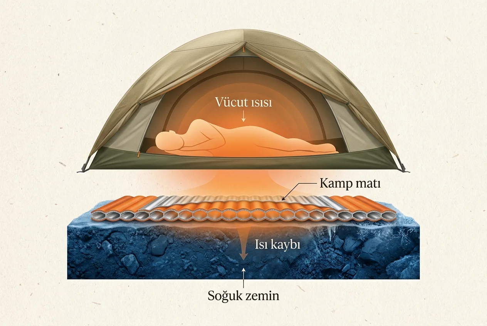
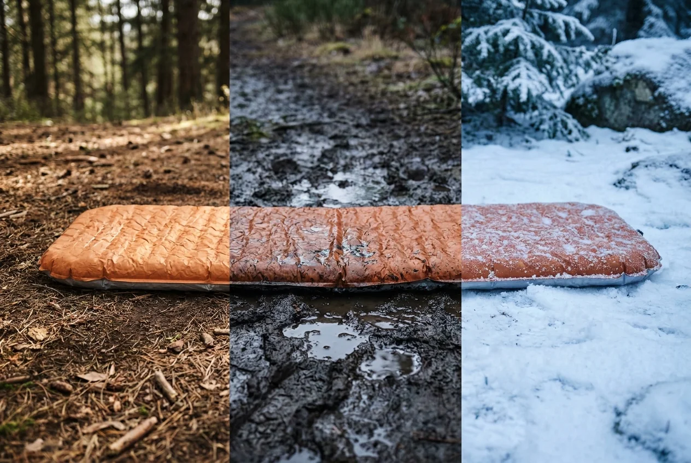
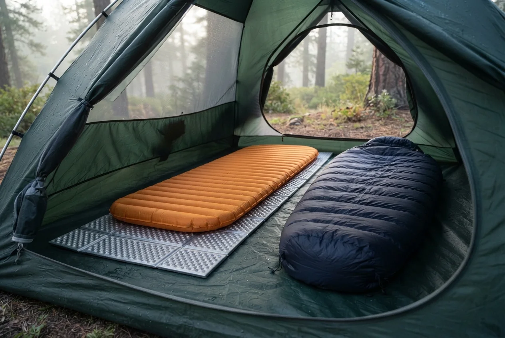
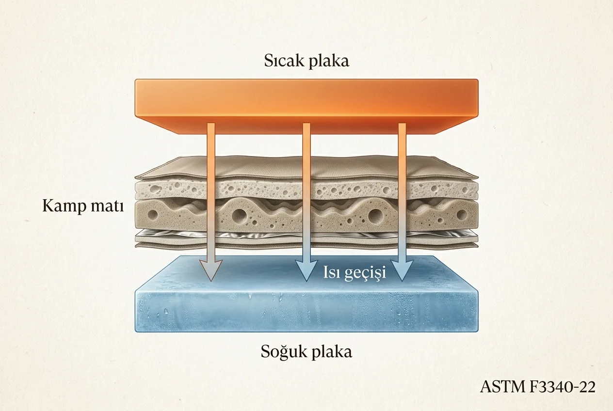

The R value indicates how well a sleeping pad resists the transfer of heat from your body to a cold surface. As the number increases, the pad’s insulation improves. In essence, a high R value means there’s a stronger thermal barrier between the pad and the ground.

This is not a temperature rating. You cannot simply say “suitable up to this temperature” for a mat with an R-value of 4. It varies depending on the air, ground moisture, the sleeping bag you use, your clothing, and your sensitivity to the cold.

For me, the R value is a very important selection criterion. When buying a camping mat, I don’t just pay attention to the number on the packaging, but also to which standard that number was tested according to. I tend to trust companies that provide such detailed information and clearly share their test results. My opinion is that companies that demonstrate this level of attention generally have better material and workmanship quality, which increases the likelihood of the product lasting a long time.

Of course, a single high ‘R’ value is not a guarantee of durability. However, testing and transparency are among the most useful indicators when making a purchase.

## What is the R value?

The sleeping bag and the mat have different functions. The sleeping bag tries to maintain the warmth surrounding your body. However, the filling beneath the bag is compressed by your body weight, and loses a significant portion of its insulation.

At this point, the camping mat comes into play. The mat’s function isn’t simply to minimize the feeling of the stones and roots; it’s also to provide insulation against the cold ground.

*Your sleeping bag and mat work together. The mat reduces the heat you lose to the ground.*

If your thermal suit seems to have adequate warmth, but you feel cold on your back and hips, the problem might be with the layers underneath the suit. Adding an extra layer on top might help, but if you’re still feeling cold and have lost heat from below, the issue remains with the base layer.

## Does a high R value mat make it warmer?

The mat itself isn't inherently warm. It gets warm depending on the temperature of the surrounding environment; when you lie on it, your body heat begins to warm it.

A high-R value mat helps to limit the escape of this heat to the ground. Therefore, you might feel like “the mat is warming me,” but its function is not to produce heat, but to reduce heat loss.

Write a high R-value mat; don’t assume it will necessarily be uncomfortable. It doesn’t function like a mat heater. However, models offering higher insulation often tend to be heavier, bulkier, or more expensive. When choosing a mat for a summer camp, it’s important to consider not just the R value, but also factors like weight, package volume, comfort, and durability.

## What should the Mat R value be?

This question doesn’t have a single, universal number that applies to everyone. When planning your camping trip, you should consider the season in which you’ll be camping, as well as the ground you’ll be camping on. A dry summer camp, wet ground, a high-altitude yayla, or camping on snow do not all create the same conditions.

The same mat may not provide the same comfort on dry ground, damp soil, or snow.

When making your choice, you can use the following order:

1. Investigate the lowest nighttime temperature you can expect at your camping location.
2. Be sure to consider the possibility that the soil is wet, frozen, or covered in snow.
3. Evaluate the comfort level of the sleeping bag you are using.
4. Don’t forget your personal sensitivity to the cold.
5. Please check the manufacturer’s usage instructions and testing methods.
6. Give yourself a margin for colder conditions when choosing an R-value.

Reading the R value on its own, like a seasonal label, can be misleading. The same “three seasons” phrase can represent different conditions in various brands and in different geographical locations. It’s more reliable to evaluate the number in conjunction with the usage conditions.

## If two mats are used one on top of the other, do the R values add up?

Yes. When you use two mats together, their insulation ratings roughly add up. Put a foam mat with an R-value of 2 under an inflatable mat with an R-value of 3, for example, and you get a sleeping surface rated around R 5.

The foam mat beneath the inflatable mat provides both insulation and additional protection against the ground.

This method is particularly useful for strengthening the existing system in cold weather. The foam mat below can also protect the inflatable mat from sharp rocks and small irregularities in the ground.

Treat the combined figure as an estimate. How the mats fit together, whether they slip, how firmly you inflate them and how much you move in your sleep can all affect the warmth you actually get.

## How is the R value tested?

For camping mats, the current and comparable testing method is `ASTM F3340-22`. During testing, the mat is placed between two hot and cold plates with a specific pressure. The energy transferred from the hot side to the cold side is measured, and the mat’s resistance to heat transfer is calculated.

*The standard laboratory test compares mats by measuring heat transferred from a hot side to a cold side.*

There’s some laboratory work coming up, actually. But, from a user’s perspective, the benefit is quite simple: you can compare the R values of two fabrics being tested using the same method in a much more meaningful way.

Let's address a specific point here. The standard used for the R value of camping mats is ASTM F3340. `ISO 23537-1:2022`, on the other hand, concerns the temperature performance, dimensions, and labeling of adult sleeping bags. Therefore, when setting up a good sleep system, it’s more accurate to look for the ASTM test on the mat and the ISO temperature values on the sleeping bag.

## Will the lab results translate exactly to real camping?

No. The standard test provides a repeatable comparison; however, it does not guarantee the night you will experience in the field.

The most crucial details that can change the outcome in real use are:

* Wet or damp ground can transfer heat faster than dry ground.
* The movement of air within the inflatable mat can increase heat loss.
* If the mat doesn’t support you evenly, some parts of your body may sink in further than others.
* Your sleeping position and movement throughout the night alter the distribution of pressure.
* There may be additional heat loss from the sides and exposed areas.
* A sleeping bag, clothing, fatigue, and your personal metabolism all affect the comfort you feel.

Therefore, when checking the inflatable mat in the store, don’t just see if it’s soft. Also, check how stable it is when you lie on it and turn left and right. A mat that looks good on paper might not perform as well at night if it’s constantly undulating like a small sea bed each time you turn.

## Is the R value truly tested, and how can it be determined?

On the product page, simply seeing a large “R” is not enough. Look for the following information:

* It is clearly stated that the R value is measured according to the `ASTM F3340` standard?
* Has it been specified whether the test was conducted by the manufacturer or by an independent laboratory?
* Does it provide clear information about the brand test method and its results?
* If the values for the same model change in different thicknesses and sizes, are these changes described separately?
* Is the product’s weight, fabric, repair possibilities, and warranty conditions also clearly stated?

Some products may only display an estimated or manufacturer-stated figure instead of a “tested R-value.” It is not advisable to directly compare such a figure with another product measured to ASTM standards.

I pay close attention to brands that provide detailed technical information. If a company clearly explains the limits, testing, and maintenance of its products, not only do they craft a nice marketing phrase, but they also demonstrate how well they understand what they do.

## Is it sufficient to only look at the R value when choosing a camping mat?

No. R value is a strong measure for comparing insulation performance, but it does not describe the entire text.

When considering a good camping mat, take the following into account:

* A tested R-value suited to the conditions you expect
* The appropriate thickness and width for your sleeping position.
* It stays steady when you roll over.
* How much weight and bulk you can carry
* The fabric’s durability
* The area is repairable.
* Valve and stitching quality
* Warranty and spare parts support

No matter how good the mat is, if the sleeping bag is inadequate, you still won’t have a comfortable night. Similarly, even a very good sleeping bag can’t fully compensate for a mat that’s weak against the ground. You need to think of these two not as separate items, but as a single sleep system.

For the other half of your sleep system, see [how to use a sleeping bag](/uyku-tulumu-nasil-kullanilir/). If you need a new bag, read [what to look for when buying a sleeping bag](/uyku-tulumu-alirken-nelere-dikkat-edilmelidir/).

## What should be remembered regarding the R value?

Here’s a brief summary:

* The higher the R-value, the better the mat insulates you from the ground.
* R value is not a direct temperature measurement.
* Search for ASTM F3340 standard for comparative testing on camp mats.
* The ISO temperature test for sleeping bags is not the same as the mat's ASTM R-value.
* If you stack two sleeping mats, their R-values roughly add together.
* The laboratory value is important, but factors such as moisture, soil, and the balance of the mat, as well as personal conditions, ultimately determine the real result.
* Evaluate R value considering comfort, weight, durability, and repairability.

For me, good equipment isn’t just equipment that looks good. It’s equipment whose values have been measured, whose limits are honestly stated, and that has been carefully made to last for years.

Could you please share the mat’s brand and model, its R-value, the nighttime temperature, and ground conditions in the comments? This way, people researching the same mat can see not just the number on the label, but also the actual experience of using it.
