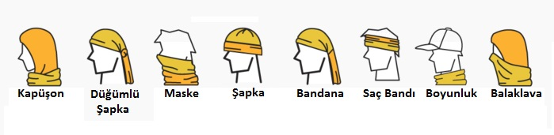

Buff; it’s a versatile outdoor sports accessory that can be used as a neck gaiter, hat, mask, or bandana. You can find its uses, advantages, and how to wear it in this brief guide.

## Quick summary

- Uses: neck gaiter, hat, bandana, hair band, and face protection
- Activities: Camping, hiking, running, cycling, skiing, and motorcycling
- Selection criteria: Fabric, breathability, stitch structure, and weather conditions
- Maintenance: Please follow the washing and drying instructions on the product label.

## What is a “buff,” and what does it do?

This is a two-sided, tube-shaped fabric that can be used in various ways for nature walks, trekking, and hiking, as well as in daily life. You can find models available on the market in synthetic, wool blends, and various thicknesses. Choose your fabric not only based on the material itself, but also according to the temperature and level of activity you’ll be engaging in.

## Buff features

Many models are easy to wash, dry quickly, take up little space, and provide protection against light breezes. Breathability, sun protection, and odor control vary depending on the product; microfiber fabric alone does not mean it is antibacterial.

## What activities does “buff” (referring to the specific “buff”) get used in?

You can use these for nature walks, trekking, and hiking, as well as while cycling, skiing, running, motorcycling, and in daily life. In cold weather, thicker or wool blends are preferable; in warm weather, lightweight, quick-drying, and breathable models are more suitable.

## How should one dress for a *buff*?

You can use this scarf, hood, face mask, or bandana in many different ways. Make sure it doesn’t obstruct your vision and doesn’t make breathing difficult. See the image below for different uses.

## Route guides you can use

- For long-distance preparation, review the [Likya Yolu route plan](/likya-yolu-rotasi/) article.
- For use in rural conditions, refer to the [Acelle Yaylası](/acelle-yaylasi/) guide.
- Head to the routes at [Karacaköy Göleti](/karacakoy-goleti/) for a short walk around İstanbul.
