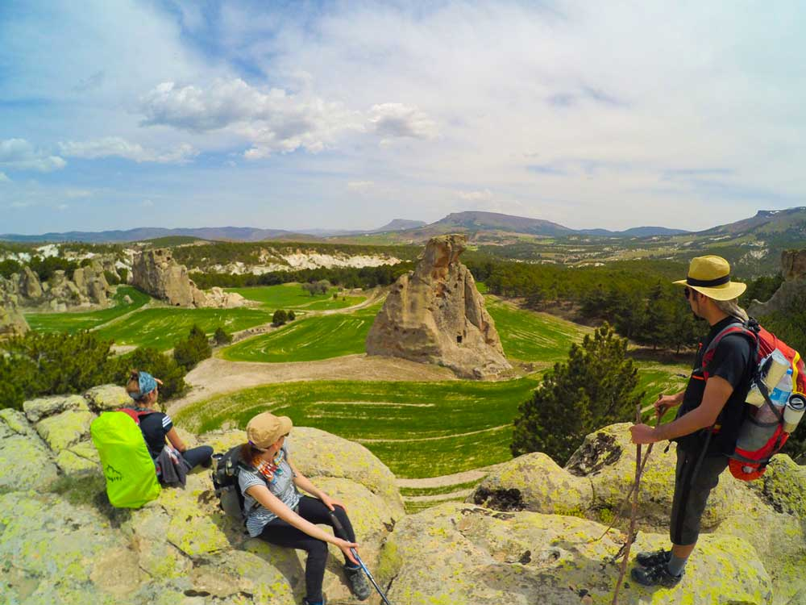
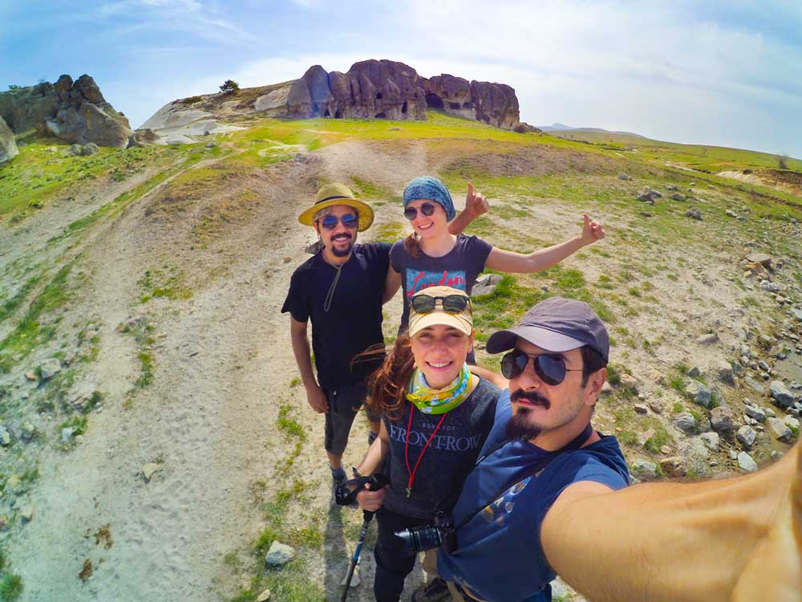
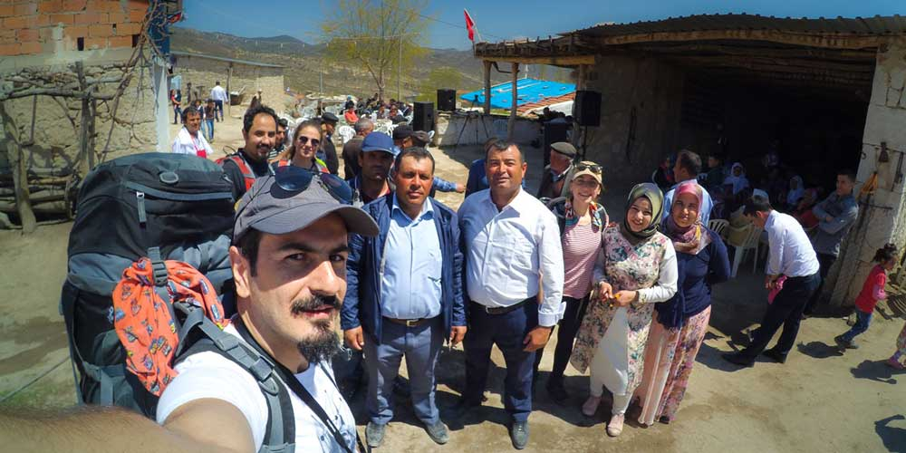
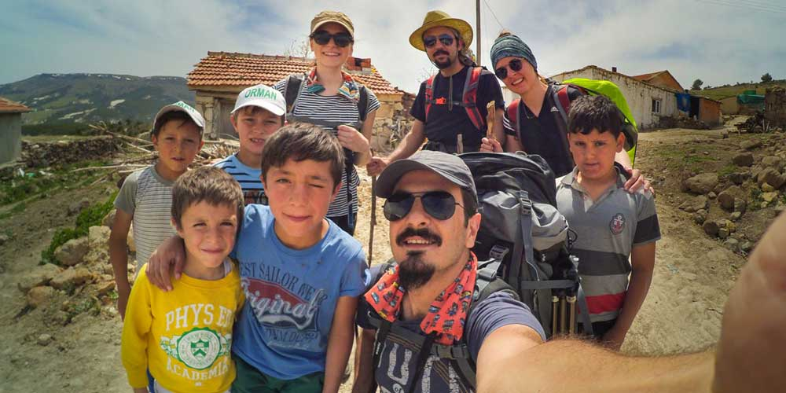
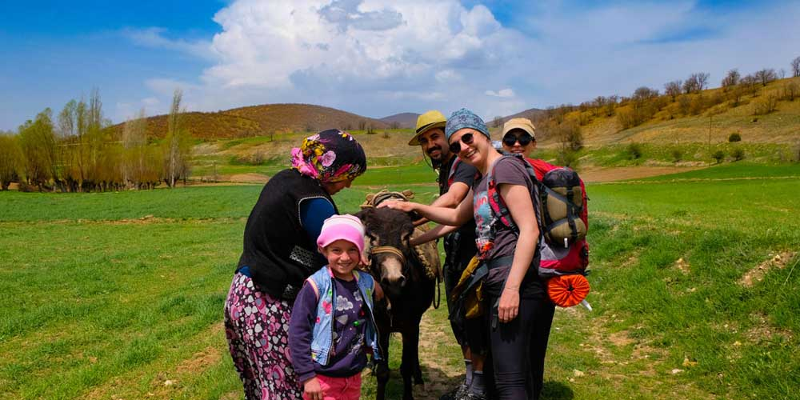
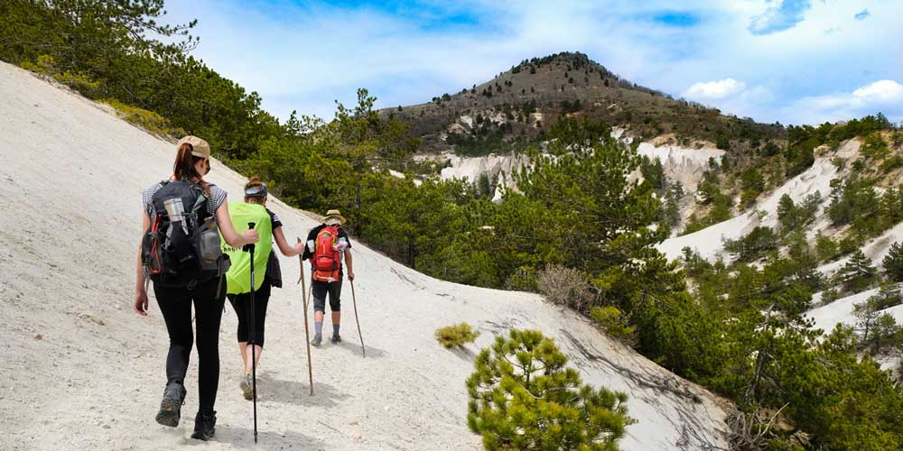
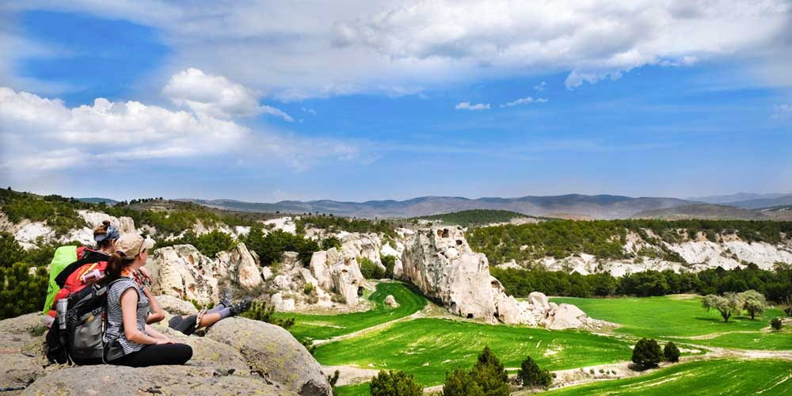

After starting a friendship with Hüseyin Sarı on Facebook, I began seeing posts like “The Phrygian Road Awaits You,” filled with beautiful photos. I was wondering, what exactly was the Phrygian Road, who were the Phrygians, and there was a road, when I purchased Hüseyin Sarı’s “The Phrygian Road” and waited for it.

## FRIG PATH PLAN

Taking advantage of May 1st, 2017 falling on a Monday, we decided to embark on a three-day Frig Road adventure. The Frig Road is 506km long and forms a beautiful hiking route situated within the Eskişehir-Afyon-Kütahya triangle. The Frig Road has not yet reached the level of popularity enjoyed by the Lycian Way, and for me, it remains a new route. I am certain that this region, which harbours such a beautiful and ancient civilisation, will become increasingly popular in the coming years. Having begun to examine the Frig Road book, I realised how wonderful the routes were; I was even considering taking a detour and extending our three-day plan to a week, but unfortunately, we did not have enough time. The best route we could undertake for hiking was to start at 1.1 Seydiler – Karakaya and finish at 1.8 Eski Eymir – Ayazini. The plan was set. We had 3 days to drive 6 hours to the start, walk about 40 km, get back to the car somehow and drive another 6 hours home to İstanbul. I knew it was a somewhat demanding plan, but why not? I hoped that if everything went to plan and my battery did not run out, we could succeed.

## Getting ready to set off

We set off after work on Friday. Getting out of İstanbul was painful as usual. We reached the teachers’ guesthouse in Afyon at around 12 that night. We’d talked about pitching a tent somewhere, but who wants to do that in the middle of the night? We changed our minds and went to the guesthouse. We booked its last 2 rooms. People who arrived 5 minutes after us were told there were none left. Getting those 2 rooms felt like a victory. After 6 hours on the road, a soft bed and a morning shower followed by breakfast felt wonderful. What else could we want? We didn’t waste time in the morning getting to the turn for Karakaya village on the Afyon–Ankara road, where we were starting the walk. We’d meant to leave the car in the village, but the roadside works site looked suitable. We told the staff what we were doing, asked permission and left the car in their car park. Knowing it was safe put our minds at ease.

## First step to Phrygia

I didn’t mention the team. Instead, I, Simge, and [NeedleSea ( Deniz, also known as NeedleSea)](https://www.instagram.com/needlesea/) began our hike on the Frig Trail. I turned on the GPS and recorded every step. But, within 5 minutes, we realized we had forgotten to apply sunscreen. To avoid becoming like a lobster under the sun, we applied sunscreen and continued towards the Frig valleys. We had a plan and a goal, but, as always, we decided to embrace spontaneous stops along the way. We planned to set up camp in a place where we were tired. Because there were many fountains along the trail, we only carried enough water – about 2 liters per person. In addition to that, we had enough food for 3 days (pasta, bulgur, and breakfast items), a tent, a sleeping mat, a sleeping bag, and only spare clothing. Also, I had about 2-3 kg of electronic equipment. If I want to take beautiful photos, I need to carry all of this. Over the years, my camping equipment has become smaller and lighter, but the equipment I carry for taking photos has always increased.

## FRIGYA: A WEDDING IS SCHEDULED

As soon as we started the road, we could see the traces of the Phrygian civilization. When we approached Keserler village, a group of children greeted us. They told us that they were having a wedding and that their elders had invited us to the wedding. We had just taken a short break, although I wasn’t keen on another break as captain, we had to accept their invitation and went to the wedding venue. They thought we were foreign tourists, but when they realized we were Turkish, we had a little chat. The tables were set up, the drums and zurnas were being prepared, and the village had been transformed into a wedding venue. They were very kind to us, and they offered us wedding food. We asked for permission, saying the road was long, and we set off again.

The slope leading up to Ağın dağı made us a little sweaty, but we quickly recovered thanks to the excitement of the first day. However, there’s a very tricky passage to navigate as we moved past the caves on Ağın dağı – a steep slope and its small, rocky nature can cause your feet to slip. If you don’t have a lot of experience, we strongly recommend using a stick and being extremely careful when crossing this area, as you could lose your balance and slide down 30-40 meters, resulting in a serious injury. The caves on Ağın dağı, however, are truly worth seeing. We decided to set up camp in a flat area, near a well, before reaching Duraklar Mahallesı. Aside from shepherds, we didn’t see anyone else around. After a bit of conversation by the fire, we went to sleep early. We successfully completed Route 1.1-1.2-1.3 on the first day. Although there weren’t many signs on this part of the route, the signs were very clear, and we continued by following our GPS.

## Went fingers 

On the second day, we woke up early and, while gathering our tents, a shepherd and his wife arrived. The wife was overburdening the poor donkey, and because of this, it kept falling down frequently, and she was brutally hitting the animal with a stick. We also received a stick from her, and we wanted to tell her that what she was doing was wrong, but our message wasn't getting through. So, we continued on our way, and occasionally we encountered stray dogs on the road. When we responded to their aggressive behavior with equal aggression, they became frightened of us, of course. In the early days, Deniz said that the dogs would attack, but on the last day, he chased them. You can scare off other stray dogs besides well-trained ones by throwing rocks at them or shouting at them. The route continued to show us all the beauty of the Phrygian region, and we continued on our way with wonderful views, arriving at Alanyurt. Here, we were relieved of the need for cold drinks, finding a market. While resting in front of the market, an older gentleman asked us to help him push the car. Of course, we did, and when we helped push the car, Yunus exclaimed, "Wow, Ibrahim, what did you do?" When I looked, I saw that Yunus's fingers were trapped, so I immediately opened the door. At that moment, the gentleman who had been pushing the car started it up. We then focused on saving Yunus's fingers. Luckily, the car was old and had some gaps, and there were no major problems besides the fingers being crushed. We applied ice treatment and soothed some of the pain. Afterwards, the part of the route we disliked the most was the 4km stretch of asphalt between Route 1.6 Alanyurt-Selimiye. We completed this section and arrived in Selimiye. Walking along the side of the road wasn't very pleasant, we wished it could have been done from another place. When we arrived in Selimiye, we were looking for a place to set up our tents. We set up our tents near the well near Ibrahim’s old carved church, to avoid being inside the village. A nice campsite, flat ground, and no one around.

## FRIGYA: ASSAULT ON A DON

And now we've reached the final day. After waking up early and having breakfast, we visited Ibrahim's place before setting off to continue our route. After walking for a while, we arrived at a large area where an elderly man, a woman, and a child were working in a vast field. There was also a donkey tied under a tree. As we approached them and began chatting, we looked up just as the donkey reared up on its four legs and came straight towards us. The woman, the elderly man, and the child were running. The dogs were attacking, but I wondered what the donkey was doing. I didn't know if it was charging or fleeing. I ran forward, spread my arms, and shouted, "Hoop müdür!" again. "But the donkey is coming straight at us on its four legs." With no other option, I picked up a stone from the ground. What am I to do now? For a moment, I felt as though I had stepped into an arena with gladiators. It felt as if we were about to clash with the donkey in the arena. But at the same time, I was also getting scared. In the last moment, the donkey changed direction by ninety degrees and continued running towards the other side of the field. The woman and the elderly man told us that they had cut the donkey's rope and chased it away. Once the animal, which had been lying down all winter, suddenly stood up and started running around, I began to shout, "Let me run around here too!" As the exhausted donkey calmed down a little, we helped them catch it, and finally, we won.

As we approached Ayazini, there was a dam lake. Because the trail here was narrow and uneven due to the slope, it was a bit tiring. After the dam, there was a steep climb. Since our group decided to protest, we didn't go further and reached Ayazini via a dirt road. We finished our hike at Şefika Teyzenin Yeri, a place where you can stay and eat gözleme. We buried the gözleme. Afterwards, we went to the place where Şefika Teyze had arranged a taxi to drop off our car. We placed our belongings in the car, tidied up, and set off for İstanbul with our Frig memories. After another six-hour journey, we finally arrived home.

## Next Frig Trail Hiking Plan

Our 3 days on the Phrygian Way swept us away. The views, the history and culture of the trail, the people we met, all of it was wonderful. On the way back to İstanbul we were already planning our next walk on the Phrygian Way. Moving to London put those plans on hold. One day I’ll return to walk all of Phrygia. 

