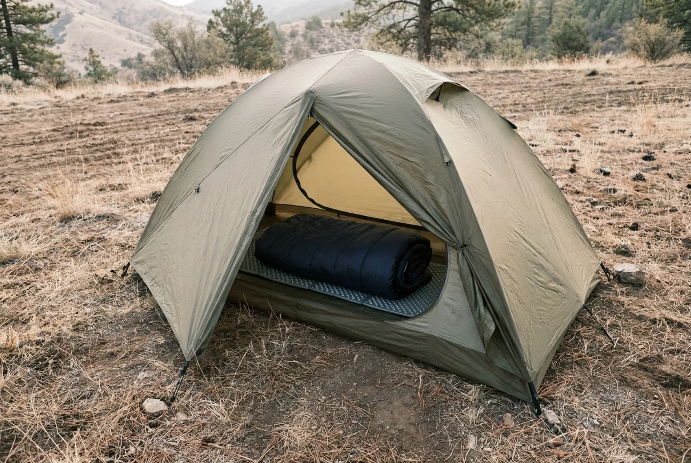
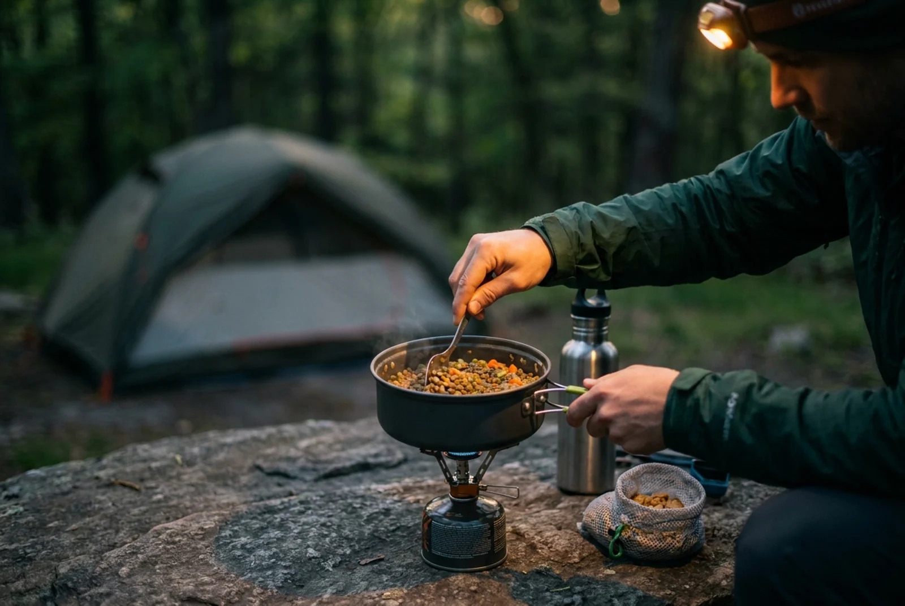
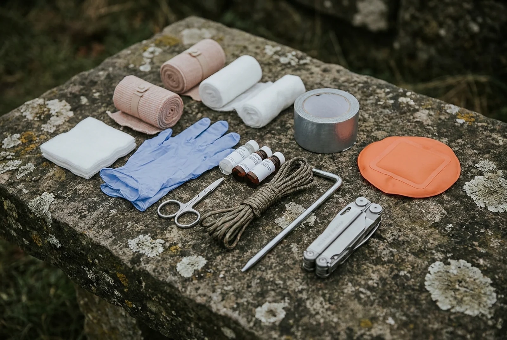
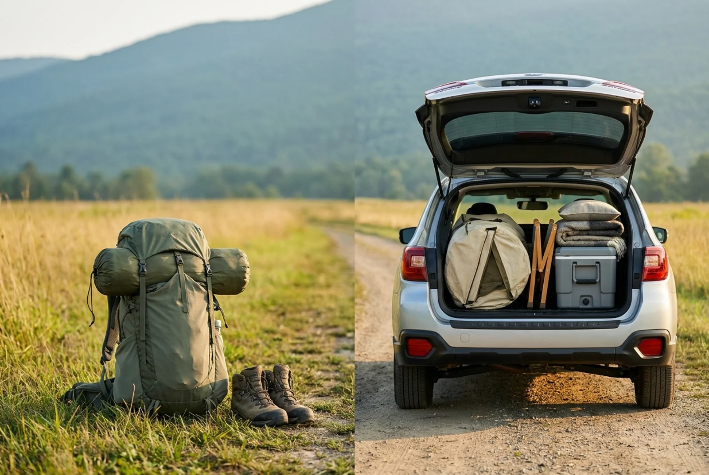

The list of necessary items for the first camping trip is growing longer and longer as you can find it all over the internet. At one point, people are starting to think they’d rather be running a small hardware store than going camping. However, for your first camping trip, you don’t need to buy everything imaginable; instead, you should focus on establishing a simple system to meet your needs for shelter, sleep, water, food, lighting, and safety.

When choosing camping equipment, first determine where and how you will go. The list of someone traveling to a car-accessible camping area will not be the same as the list of someone carrying their equipment and walking. [Choosing a camping area for your first trip](/ilk-kamp-nerede-yapilir/) – after you’ve done that – you can narrow down the following list according to your own conditions.

## What are the essential equipment needed for the first camping trip?

To ensure a safe and reasonable level of comfort for the first night, your core system consists of the following components:

- Tent: A shelter for protection against rain, wind, insects, and nighttime privacy.
- Sleep sack: Sleep equipment designed to help maintain the heat your body produces.
- **Camp mat:** A material that makes the ground surface more comfortable while also reducing heat loss from the ground due to an insulating layer.
- Illumination: A headlamp or flashlight and spare batteries.
- Water: A pre-determined amount for drinking, cooking, and basic hygiene.
- **Food:** Foods that are suitable for your cooking capabilities and the length of your camping trip, and which have a low risk of spoilage.
- Appropriate weather attire: Rain gear, dry backup clothing, and warm layers for nighttime.
- Contact and navigation: A fully charged phone, a power source, route information, and, if possible, a paper backup.
- First aid and repair: Personal medications, basic first aid supplies, repair tape, and small multi-purpose tools.

Tents, sleeping bags, and mats should be considered as a complete sleeping and shelter system—items that work together. If one of these items is missing or not suitable for use, it won’t fully compensate for the deficiencies in the other equipment.

The tent provides protection from outdoor conditions; the sleeping bag supports body warmth, and the mat provides insulation against the ground.

## How do you choose a tent, sleeping bag, and sleeping mat?

When choosing a tent, consider your carrying method and the expected weather conditions based on the number of people. If you’re camping by car, interior space and easy access may be important. If you’re hiking with a backpack, weight and pack volume will be key. You can compare these decisions in more detail in the article “[Çadır alırken nelere dikkat edilmeli?](/cadir-alirken-nelere-dikkat-edilmeli/)”.

When choosing an overnight bag, rely on the lowest number indicated in the guidelines, but don’t settle for it. Consider both the lowest nighttime temperature and the comfort level you expect. For guidance on how to use the bag, what to wear inside, and why the mat is important, refer to [how to use an overnight bag](/uyku-tulumu-nasil-kullanilir/).

When choosing a sleeping mat, don’t just focus on softness. Cold surfaces also require attention to R value, thickness, package volume, balance, and durability. “[R value what?](/r-degeri-nedir/)" explains how to translate the insulation value of a camping mat into daily usage scenarios.

## What should you buy for lighting, water, and food?

The flashlight on the phone is useful in emergencies, but it shouldn’t be the only part of a campsite’s lighting plan. You’ll immediately notice the difference when using a headlamp – it allows you to keep your hands free, whether you’re setting up a tent, preparing food, or going to the toilet at night. Don’t forget to also include a spare battery or charging plan on your list.

Do not base your approach on the statement “start by assuming there’s a water source there.” The blue line on the map does not indicate potable water that flows continuously throughout the year. Bring your own drinking water when choosing your camping spot, or follow the instructions for your filter, tablets, or boiling method if you need to purify the water. If you are unsure about the safety of the source, do not drink it.

Keep the initial camping meal plan simple. Using foods that can be prepared with a single pot, durable fruits, and pre-measured drinks will prevent you from carrying unnecessary equipment. If you are using a stove for cooking, do not operate a fuel-powered device inside the tent, at the entrance, or in the enclosed luggage compartment. The stove should be used outdoors on a stable surface, and you must adhere to the campsite’s fire regulations.

The headlamp allows you to keep your hands free; however, the camp stove should only be used in an open and safe area.

## What should be included in a clothing and personal care list?

You don’t need to bring your entire wardrobe when going camping. However, you should have a dry backup plan in case of getting wet or sweating:

- Weather forecast – basic layers
- Rain and wind protection
- Dry socks and an inner layer
- For nighttime, a separate, dry sleeping aid.
- According to the season, a hat, a cap, or gloves.
- Toothbrush, small towel, and personal hygiene products
- A robust bag for transporting toilet paper and waste.

It’s not a good idea to go to bed in a sleep sack after wearing sweaty clothes during the day. Wet clothes will make you cold, moisten the sleep sack, and leave you with damp clothes the next day.

## What should be included in a first aid and repair kit?

First aid kits are not the same for everyone. The medications you use regularly, your allergies, and the distance to where you’re going all change the list. A basic kit should include bandages, gauze, antiseptic, gloves, a small scissor, and personal medications. When it comes to medication, consider your own health condition, the advice of your healthcare professional, and the product instructions.

*A small, basic first aid and repair kit should consist of the essential items you actually know how to use.*

Regarding repairs, small but effective materials are sufficient:

- Patch tape
- Several meters of solid rope
- Spare tent stakes
- A small piece of string or a small rubber band.
- If you are using an inflatable mattress, use the manufacturer’s repair kit.
- Knife or multi-purpose tool

Instead of carrying incompatible spare parts for a camp stove, tent pole, or mat valve, try your equipment at home. It’s not a great time to figure out “is this piece supposed to go here?” on the first morning of your camping trip.

## Why is the list of car trips, camping trips, and hiking trips different?

If you’re going camping in a car, items like a table, chairs, or a large cooler can enhance your comfort. These aren’t essential – they can simply be chosen because they reduce transportation costs.

Driving is preferable for camping; when hiking, you have to carry every part’s weight on your back.

If you’re taking a short walk to the campsite, you’ll be carrying the weight of everything on your back. In this situation:

- Do not bring two of the same product with you.
- Measure the package volume and total weight at home.
- Know in advance how far you will carry the water.
- Reduce large packaging and unnecessary single-use packaging.
- Add comfort equipment after basic shelter and safety equipment.

During your first camping trip, you’ll realize that you’re missing a certain comfort item, which you’ll complete on your next trip. However, unnecessary weight can quickly drain your camping enthusiasm from your back down.

## How should you check your camping equipment before leaving the house?

Instead of haphazardly filling the equipment bag, check it according to the camping schedule:

1. Are the tents, poles, stakes, and ropes all ready?
2. Is the Tulum, mat, and dry sleeping bag ready?
3. Is the lighting and backup power working?
4. Is the water and food plan suitable for the duration of the camping trip?
5. January, fuel, and cooking equipment – are they compatible?
6. Is there a rain and temperature layer suitable for the weather conditions?
7. Is the supply of first aid, personal medication, and repair materials complete?
8. Did you get a bag for trash and wet clothes?
9. Were the route, permit, and camping area regulations checked?
10. Does someone close to you know where you are?

When you get back home, be sure to set up and clean the equipment. Leaving the wet tent and suit in your bag is a way to prepare for the first problem of the next camping trip, right at home.

## How can we simplify the packing list for the first camping trip?

You don’t need to acquire everything at once. First, address your basic needs: shelter, sleep, water, food, and safety/security. Once you’ve experienced camping a few times, add any comfort items you truly miss.

This isn’t the longest camping list. It’s the list that’s best suited to your destination and how you’ll be carrying it, one that you’ll have used completely when you return home.

What was the item you took with you on your first camping trip, which you later realized was unnecessary? If you describe the usage conditions rather than the brand and model, you could create a more helpful list for beginners.
