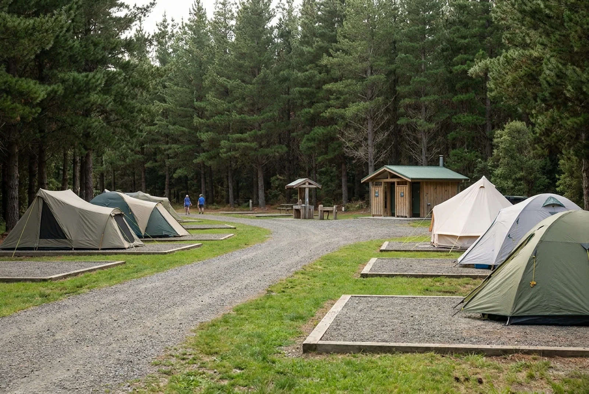
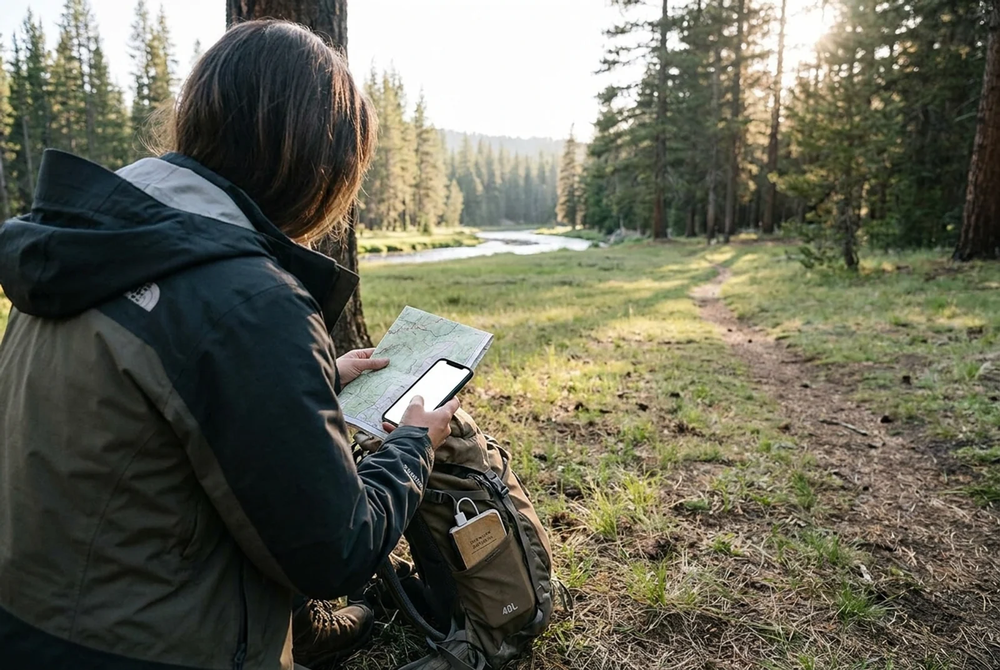
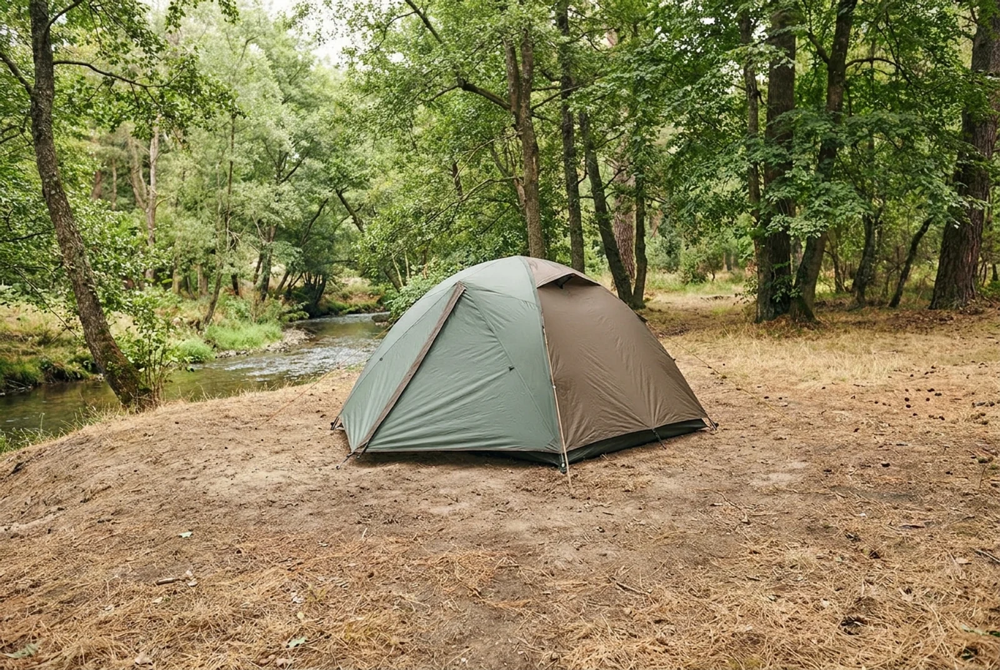
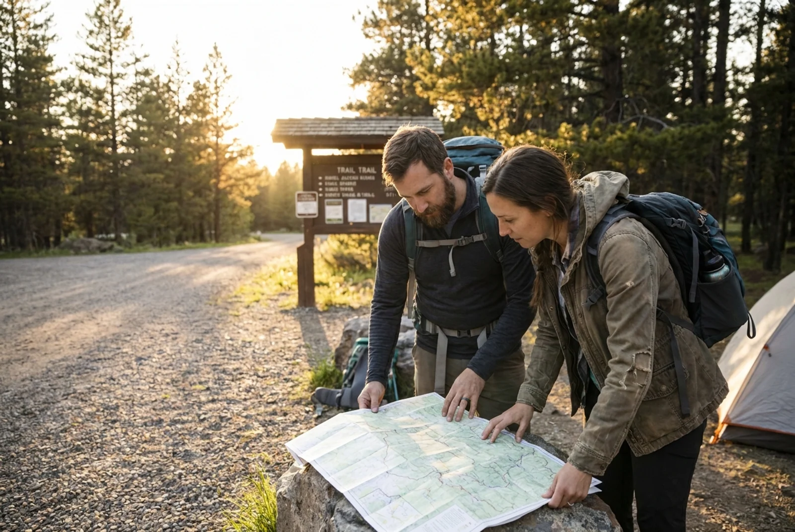

You don’t need to travel far for your first camping trip. Spending hours getting away from home can make your first night harder. A good campsite for a beginner is one you can find easily, check the weather for and leave if needed, and where camping is permitted.

The view matters, of course. But before you worry about a good view on your first camp, think about how you’ll get through the night, where you’ll find water and what you’ll do if something goes wrong. Nature doesn’t give you an exam paper; it shows up any lack of preparation straight away.

## A managed campsite or wild camping?

If you’ve never pitched a tent, a managed campsite or a site where camping is permitted and basic facilities are available can be an easier start. Toilets, water, road access, other campers and somebody you can ask for help make the first night more predictable.

*Toilets, water and marked pitches can make your first camp easier to manage.*

You can also camp somewhere without a managed site. In that case, you’re responsible for the pitch, water, toilet arrangements, access, weather, fire and emergency plans. The idea that anywhere outdoors is a campsite sounds liberating, but you can’t pitch a tent on every attractive patch of flat ground.

Rules in national parks, nature parks, forests and on private property can vary by who manages the land and what restrictions are in place at the time. Check official notices, designated camping areas and fire rules before you camp. Camping may have been allowed last year and restricted today.

## What should you ask when choosing a campsite?

Try to answer these questions before saving a location:

- Can I pitch a tent here, or is it for day use only?
- How close can I get by car or public transport?
- If I need to walk the last stretch, do I know the route and distance?
- Is there drinking water, a toilet and somewhere to put rubbish?
- Is there mobile reception? If there isn’t, where can I get a signal?
- Could rain close the road or make it difficult to drive out?
- Is there a health facility, gendarmerie post, business or main road nearby?
- Is the ground for the tent level, dry and away from flood risk?

You don’t necessarily have to give up if you can’t answer all these questions. But for your first camp, it might be wiser to choose somewhere that reduces the uncertainty. Adventure isn’t the same thing as being unprepared.

*Use more than your phone as a plan. Check the location, the access route and an alternative way out in advance.*

## How should you check the weather before camping?

When choosing a campsite, go beyond the forecast for the nearest city centre. Check the district, elevation and, if possible, exact location of the campsite. Look at the Turkish State Meteorological Service’s hourly and five-day forecasts. Check the likelihood of rain, wind, temperature, humidity and thunderstorms.

Reconsider the plan in these situations:

- There’s a warning for strong winds or storms.
- The overnight temperature is near the limit of your equipment.
- Thunderstorms, heavy rain or flooding are possible.
- Snow, ice or mud may affect access.
- It will already be dark by the time you arrive.

A forecast can help you make a decision. It can’t guarantee how the night will go. A site that looks sunny during the day can be windy enough overnight to change how your tent stands and how much sleep you get. For a first camp, choose a generous weather window, easy access and a plan that lets you turn back.

## Where should you pitch the tent?

Flat ground isn’t always good ground for camping. Don’t pitch in hollows that collect runoff, in stream beds, under loose rock or beneath trees with dead branches overhead. A pitch by the sea, a lake or a stream may have a good view. Take water levels, wind and overnight damp into account too.

Walk over the spot before pitching. Move sharp stones and sticks aside without digging or reshaping the ground. It’s usually more practical to turn the door away from the wind, choose a spot where water runs away from the tent and keep a view of your surroundings.

*Check even a flat pitch for runoff, dead branches and the slope of the surrounding ground.*

For more on picking and securing a tent, see [what to look for when buying a tent](/cadir-alirken-nelere-dikkat-edilmeli/).

## How far should you go for a first camp?

What matters on the first trip is how manageable it is. A campsite close to home might not sound as impressive. But it’s an advantage if the weather turns, you find you’ve forgotten something or you realise you can’t get to sleep in the tent.

For the first night, pick somewhere you can reach in daylight, with an access route you can check in advance and the option of returning that day. Plan your arrival so you have time to pitch the tent before dark.

*Arriving in daylight helps you see the ground and assess your options for getting home.*

## Who should you share your camping plan with?

Leave these details with someone you trust before you go:

- The campsite name and location
- Your route there and back
- Who is going with you
- When you’ll check in
- How you’ll get in touch if plans change

Share this information even if you expect to have mobile reception. Your battery may die, your phone may stop working or the signal may be weak. A screenshot of the route and a written address can help.

## First campsite checklist

Here’s the order I’d use to plan that first night.

1. Choose an easy-to-reach site where camping is permitted.
2. Check official rules and current restrictions.
3. Look at the hourly forecast, including wind and chances of rain.
4. Make a note of water, toilets, phone reception and emergency exits.
5. Share your camping plan with someone.
6. Set off in time to arrive and pitch your tent in daylight.

This plan can’t shield you from every surprise. Meeting a few surprises is part of camping. It does keep your first night from turning into a test where you have to solve five unfamiliar problems at once.

Once you’ve picked a campsite, make a [gear list for your first camp](/ilk-kamp-icin-gerekli-malzemeler/) and read [Is wild camping safe?](/dogada-kamp-yapmak-guvenli-midir/) to prepare for safety.

Where did you first camp, or what sort of place are you looking for? Sharing what you’ve learned about access, water, weather and pitches in the comments can help someone planning the same trip.
