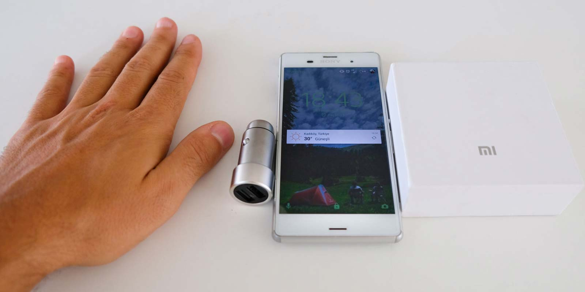

When the car chargers I bought from all over the place broke, I needed to get a new one. Having previously used and been happy with Xiaomi’s products, I went straight for the Xiaomi Mi car charger. I’ve been using this product, which I bought from Ali (AliExpress) for $10, for a while now, and I’ve been observing it. Specifically, my battery would run out when going to and from camp, and since I wanted to use the spare charger only during the activity itself, I was having charging issues. Despite being more expensive than products sold for 20TL, it’s worth every penny. Here are the biggest advantages it provides:

* It has 2 USB ports
* It delivers 2.4 A at both of its 2 outputs, with a maximum output of 3.6 A.
* Fast charging
* The silver color’s very elegant design, combined with the blue light that appears when it’s attached to the rearview mirror, makes it look even better.
* Solid.

Currently, I don’t have any charging issues with my car :). It’s a product that’s delivering on its value for now. If it breaks or I experience any other problems, I’ll let you know. I’ve been using it for approximately 3 months, and I’m quite pleased with it. Anyone who wants to buy it from AliExpress can search on Google for “Xiaomi Mi Car Charger”. I bought mine here.

